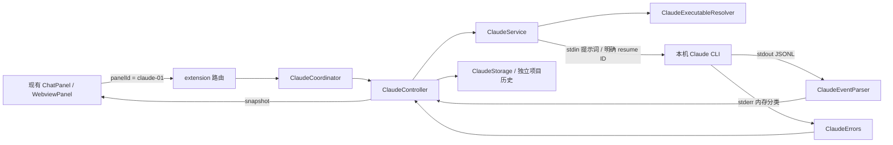

# Task 03：Claude Code 接入验收报告

验证日期：2026-11-12，Windows x64。版本：0.4.0。Task 03 核心功能已通过真实 Claude CLI 与正常 VS Code Extension Development Host 验证；未开发 Task 04。

## 环境与交付物

| 项目 | 实测结果 |
| --- | --- |
| VS Code | 1.146.0，x64 |
| Node / npm | v26.13.1 / 11.20.0 |
| Git | 2.56.0.windows.1 |
| Claude Code | 2.1.322 (Claude Code)，本机原有 CLI |
| Claude 授权 | 本机已有登录，本次真实请求成功；未读取或复制凭证 |
| 安装包 | `ai-team-manager-0.4.0.vsix`，16 个文件，约 65 KB |
| Git 基线 | master，a80ceb3，origin/master |
| 上游 | https://github.com/dreamcather726/AI-Team-Manager |

VSIX SHA-256：`03050b3f0904b5aadae7a7a6abe6d226169010c423af98ae2e89cfcde03822d4`。已安装至当前用户 VS Code；扩展列表确认 `ai-team-manager.ai-team-manager@0.4.0`。现有窗口需要执行 Developer: Reload Window 才会加载新版本。

CLI 来源为 VS Code PATH 中的官方 Claude Code 扩展 native binary。也支持机器级设置的明确路径，以及从 VS Code 注册表解析已启用官方扩展位置，未硬编码本机版本目录。未修改 PATH、PowerShell 执行策略、CC Switch、模型配置或授权文件。

## 模块及调用关系



GPT 继续使用现有 ChatCoordinator → ChatController → CodexService，通信与存储相互独立。仅复用既有进程启动、进程树终止、会话数据类型和原子存储基础能力。

新增生产模块：

| 文件 | 职责 |
| --- | --- |
| `src/claude/claudeCoordinator.ts` | 工作区信任与路径检查、命令、历史/项目选择、UI 事件协调 |
| `src/claude/claudeController.ts` | 单 Worker 请求状态、多轮会话、停止、重启恢复、usage 和快照 |
| `src/claude/claudeService.ts` | CLI 能力检查、异步进程、stdin、stdout/stderr 分离、超时与终止 |
| `src/claude/claudeExecutableResolver.ts` | 显式设置 / PATH / 官方扩展 CLI 查找 |
| `src/claude/claudeEventParser.ts` | UTF-8 JSONL、真实文本增量、工具与结果事件、Session 校验 |
| `src/claude/claudeStorage.ts` | 不可变快照、串行原子写入及 Windows 短暂文件锁重试 |
| `src/claude/claudeTypes.ts` | Claude 事件、工具活动与快照类型 |
| `src/claude/claudeErrors.ts` | 中文分类错误、常见敏感模式遮盖 |

修改的生产文件：`src/extension.ts`、`src/providers/dashboardProvider.ts`、`src/webview/workspace/chatPanel.js`、`workspace.js`、`workspace.css`。保留原布局，仅激活现有 Worker 01，增加独立操作栏和真实工具状态。顶部启动/暂停/继续针对当前选择的 GPT 或 Claude。其他 Claude 占位窗口仍不能发送消息。

修改的项目文件：`package.json`、`package-lock.json`、`.vscodeignore`、`README.md`、`CHANGELOG.md`。版本升至 0.4.0，增加 Claude 路径与超时设置、5 个命令；排除测试报告进入 VSIX。不创建或修改 `.gitignore`。

新增测试：`test/claude.test.cjs`、`mock-claude.cjs`、`claude-live.cjs`、`claude-real-faults.cjs`、`task03-host-live.cjs`、`run-claude-host.cjs`、`claude-browser.cjs`。修改 `test/api.ts`、`run.cjs`、`run-host.cjs`、`task02-host.cjs`、`workspace.test.cjs` 以接入测试与保留 GPT/UI 回归。

## 真实 CLI 验收

证据保存在本机 `.tools/task03-live-1794482404480/`，包括 `result.json`、`events.json`、`records.json`、`faults.json`。不上传这些运行数据。

| 测试 | 真实结果 |
| --- | --- |
| 检测与启动 | 获得 2.1.322；流式与权限参数经本机 `--help` 确认 |
| 自然语言任务 | 用户提示经 stdin，生产 Controller/Service 启动真实 CLI |
| 读取文件 | 收到 Read 开始/完成事件，回复包含 README 独有标记 |
| 修改文件 | 收到 Edit 开始/完成事件，磁盘上的 `motor_control.c` 实际改变 |
| 流式 | 捕获多次 `content_block_delta.text_delta`，并非最终回答拆字模拟 |
| 连续多轮 | 重建 Controller 后显式 resume 同一 Session，记住上一轮标记 |
| 新建隔离 | 新会话获得另一个 Session，不沿用旧上下文 |
| 中止 | 收到真实文本增量后停止，CANCELLED，部分回复与 Session 保留 |
| 进程退出 | 启动过的子进程均已退出，未检测到测试子进程残留 |
| 异常终止恢复 | 外部终止真实 CLI，FAILED / PROCESS_EXIT_NONZERO；重建 Controller 后继续同一 Session 成功 |

第一次会话：`ce5d1657-da71-4a3d-909a-70d9d47d5445`。新会话：`5dccb8c4-de8b-453b-b31d-a1cdde3ccfd9`。后者经过停止、外部异常终止及恢复，最终真实回复 `CLAUDE_AFTER_CRASH_OK`。

真实文件修改内容：

```diff
-int motor_limit(int speed) { return speed; }
+int motor_limit(int speed) { return speed < 0 ? 0 : speed; }
```

测试在独立工程进行，`protocol.c`、`main.c` 修改前后 SHA-256 一致：

```text
protocol.c e70fc20783de1b61195145cfefe0b6de9519652e1334cc4942d461952fd0e000
main.c     2ad75d95660563887d8d3f1d0ae1dcf18c2379cbd83a5c72f5ab276351ee6949
```

这是任务遵循与文件结果核验，不是执行前文件白名单拦截。未将其宣传为 Task 04 监督测试。

真实事件节选（UTC，来自上述 `events.json` / `faults.json`）：

```text
11:20:05.356 session ce5d1657-da71-4a3d-909a-70d9d47d5445
11:20:09.450 Read running
11:20:10.760 Read completed
11:20:15.237 Edit running
11:20:16.406 Edit completed
11:20:26.091 result success
11:20:27.425 session ce5d1657-da71-4a3d-909a-70d9d47d5445（续聊）
11:27:16.787 text_delta 实时文本；随后外部终止 PID 60384
11:27:16.978 FAILED / PROCESS_EXIT_NONZERO，保留 Session
11:27:22.171 text_delta CLAUDE_AFTER_CRASH_OK
11:27:22.184 result success，同一 Session 恢复
```

实现期间真实测试发现 Windows 原子替换偶发文件锁；已增加串行快照重试并重跑成功。曾有宿主测试脚本在异步启动前误判未运行；已改为先观察 busy，再等待真实输出，重跑通过。这些失败未计为通过记录。

## 正常 VS Code 宿主与安装包

真实 Claude 宿主证据：`.tools/task03-host-1794484090786/`；独立工程：`.tools/task03-fixture-1794484090720/project/`。

1. 正常 Extension Development Host 激活生产插件；注册 Claude 的检测、新建、停止、历史与项目选择命令。
2. 工作台 Webview ready。通过生产 Coordinator 发送自然语言任务，真实读取 README / motor_control.c 并写入 `// CLAUDE_HOST_OK` 注释，不改函数行为。
3. 保存 Session `fe3f2dcd-c3db-450d-8af6-6c56ff58deaf`，退出宿主。
4. 第二次启动恢复原 conversation ID / Session ID；不调用 Read 工具即可记住 `CLAUDE_NATIVE_HOST_FIXTURE`，回复 `CLAUDE_HOST_RESUME_OK`。
5. 收到长回复的真实文本后，通过已注册 `aiTeamManager.stopClaudeResponse` 命令中止，CANCELLED 且 Session 保留。
6. 最终 `stage2.json`：`restartRestored=true`、`resumedSameSession=true`、`realStreamStoppedFromCommand=true`、`uiReady=true`；`probe-complete.json` 为 ok。

GPT 回归使用专用 Mock CLI，以免重复产生不必要的 GPT 用量。最终 VSIX 安装到隔离扩展目录后，`.tools/task02-host-1794486017486/` 的两次正常宿主测试通过：激活、GPT 发消息、同线程重启续聊、命令注册、编辑器面板与三个侧边 Webview ready / CSP 均正常。没有声称该 GPT 回归是一次真实供应商请求。

## 界面截图与错误检查

截图目录：`.tools/task03-screenshots/`。

- `claude-real-conversation.png`：真实 Read/Edit 与最终回答、Session、usage，GPT 区无 Claude 消息。
- `claude-real-streaming.png`：真实长回答进行中，Claude 停止按钮可用。
- `claude-light.png`：同一真实完成会话，浅色主题变量。
- `claude-mobile.png`：390px 小屏标签模式，清空展示后历史仍保留。

这些图片使用上述正常宿主捕获的真实会话快照与生产 Webview 资产，在本地 Chromium 渲染。不是 Windows VS Code 外框截图，也没有编造在线对话。原生桌面截图工具连续两次启动失败，报告保留此限制。页面捕获前重新加载页面，避免不同时间快照的 DOM 相互残留。

浏览器验收：页面错误与 console.error 为 0；GPT/Claude 通道隔离、清空显示不改记录、小屏无横向溢出通过。检查本插件相关宿主日志无未捕获异常；VS Code 内置 Git 装饰与资源作用域提示仍存在，不据此宣称整个 VS Code 没有任何警告。

## 自动测试和构建

| 命令 | 结果 |
| --- | --- |
| `npm install` | 成功，181 packages，audit 0 vulnerabilities |
| `npm run typecheck` | 通过 |
| `npm test` | 36/36 通过，包括原 GPT 与布局测试 |
| `npm run compile` | 通过 |
| `npm run test:claude-host-live` | 正常 VS Code 宿主两轮真实 Claude 测试通过 |
| `node test/claude-live.cjs` + `claude-real-faults.cjs` | 上述真实读写、多轮、新建、停止、崩溃/恢复通过 |
| `node test/claude-browser.cjs` | 真实快照截图与 UI 检查通过 |
| `npx @vscode/vsce package` | 0.4.0 打包通过，源码 TypeScript 和运行数据未进入 VSIX |
| `ATM_HOST_VSIX=...; npm run test:host` | 最终 VSIX 安装与正常宿主 GPT/UI 重启回归通过 |

npm 提示两项安装脚本未获本机 allowScripts 授权；现有 esbuild 可正常运行，编译、类型检查及 VSIX 打包均成功。未更改 npm 的脚本授权策略。

故障处理中的未安装、启动 EACCES/EPERM、授权失效、网络异常、权限拒绝、JSONL 损坏/超长、Session 不匹配与无法恢复、超时、存储损坏/短暂锁，使用可控故障子进程或存储注入验证。没有撤销用户真实授权或制造真实网络故障；故障注入与真实 Claude 验收分开记录。真实外部终止、中止与恢复已另行实测。

## 能力边界与已知问题

- 固定单个 Claude Worker 01；新建是其独立历史会话，不是创建并行 Agent。
- 使用官方非交互流式 CLI：[headless](https://code.claude.com/docs/en/headless)、[CLI 参数](https://code.claude.com/docs/en/cli-reference)。当前只验证 2.1.322，不支持所需参数时明确失败，不降级扩大权限。
- 使用普通 `acceptEdits` 与 `permission-prompts none`。需要额外批准的 Bash/文件操作可能被拒绝；本阶段没有权限批准对话框，也没有对任意命令作成功执行承诺。权限说明见[官方文档](https://code.claude.com/docs/en/permissions)。
- 工具状态反映 CLI 事件，不是执行前拦截；Bash 工具开始/完成/失败复用同一工具事件通道，不提供独立交互终端或完整命令 stdout 面板。
- 不提供文件授权白名单、实时 GPT 监督、自动纠偏、自动验收或危险命令的自建安全沙箱。停止是进程终止，不是文件回滚。
- 推理只展示思考状态，不展示原始思维链。只持久化安全处理的会话与 usage；执行日志不复制原始 stderr、工具文件内容或聊天正文。遮盖常见密钥模式不能识别所有敏感数据，用户仍需避免发送秘密。
- 历史和 Session 持久化；工具活动为当前插件运行期间的状态，不承诺重启后恢复完整工具输出。清空展示不删除持久历史。
- 任务面板的审核门禁仍未接入自动验收，Claude 请求完成不代表 GPT 验收通过。
- 保留原有生成文件及用户工作区内容；提交仅包括此次源码、配置、文档和测试，不上传 `.tools`、VSIX、node_modules 或 dist。

Git 提交、推送短哈希和分支以本次交付消息为准，可在上游历史核对。本阶段到此停止，不进入 Task 04。
