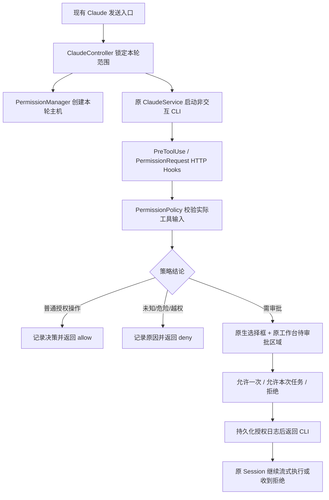

# Task 03.1：Claude Code 权限管理与人工审批

交付版本：0.5.1。验收日期：2026-11-13（Asia/Shanghai）。本次优先完成 Task 03.1；Task 05 未完成草稿保存在本地 `.tools/task05-wip-before-031/`，未混入发布版本。

## 现状检查与选择

- 工作区 `D:\Desktop\AI-Team-Manager`，分支 `master`，开始时 HEAD 为 `9f0f335`，上游 `origin/master`，沿用已有 GitHub 仓库。
- 开始时已有 `dist/extension.js`、`node_modules/.package-lock.json` 改动，本次不将它们暂存或上传。没有创建或修改 `.gitignore`。
- 本机实际 CLI：**2.1.322 (Claude Code)**，来自已安装 Claude Code 扩展的 native-binary；通过现有 resolver 解析，没有硬编码安装版本目录。
- 原 Worker 是 `--print --verbose --output-format stream-json --include-partial-messages`，属于非交互 CLI，不是终端交互或 Agent SDK。原来采用 `acceptEdits` 和 `--permission-prompts none`；需要提示的操作没有审批处理器，因此直接 `PERMISSION_DENIED`。
- 评估了官方 `--permission-prompt-tool`（需要额外 MCP 权限工具）和 Agent SDK `canUseTool`（需要改动现有通信方式）。本机 help 未列出前一个参数；本次选择已通过真实调用验证的官方 HTTP Hooks，保留原进程、解析器、Session 和授权来源。没有增加 SDK 依赖。
- 官方机制：[CLI reference](https://code.claude.com/docs/en/cli-reference)、[Hooks reference](https://code.claude.com/docs/en/hooks)、[权限评估顺序](https://code.claude.com/docs/en/agent-sdk/permissions)。

## 新增模块及调用关系

| 模块 | 职责 |
| --- | --- |
| `src/permissions/permissionTypes.ts` | 授权范围、审批操作、选择结果、日志和单次任务主机类型 |
| `src/permissions/permissionPolicy.ts` | 精确文件与命令策略；规范路径、链接、敏感目录、配置与危险命令判断 |
| `src/permissions/permissionHost.ts` | 每轮任务独立的 localhost HTTP Hooks；执行前决策、审批等待、超时和任务临时授权 |
| `src/permissions/permissionManager.ts` | VS Code 原生审批、工作台审批消息、项目授权偏好及全量脱敏 JSONL 日志 |
| `src/webview/workspace/permissionPanel.js` | 原工作台中展示权限模式、范围、待审批操作、预览、记录与拒绝原因 |

现有 ClaudeService 仅增量调整权限参数和传递本轮 settings；ClaudeController 在原发送生命周期中创建、关闭权限主机；ClaudeCoordinator 接入设置范围和审批消息。stdout JSONL 解析和 Session 恢复算法未重写。GPT Adapter、Task 04 审查引擎没有改动。



## 生效的权限机制

启动参数保留 print/stream-json/resume，权限模式改为 `manual`。每次请求用 `--settings <JSON>` 注入本轮 Hooks 及 Read/Edit/Write/Glob/Grep/Bash 的显式 ask 规则。Hooks 在进程内有效，不写入 Claude 配置。保留 `--permission-prompts none` 作为兜底：正常审批在 Hooks 内完成；Hooks 不存在或不能处理时，不会依靠不存在的终端弹窗继续执行。HTTP Hooks 设 `onFailure: block`，要求 CLI ≥ 2.1.295。

HTTP 主机仅监听 `127.0.0.1`，每次任务使用随机256位能力地址，校验请求方法、Host、工作区与 Session，最多接收2MiB事件。临时地址不会作为模型输入或授权日志保存。

| 操作 | 行为 |
| --- | --- |
| 工作区内普通文件 Read | 自动授权，敏感路径与链接除外 |
| Glob | 限工作区内相对模式，拒绝父目录/绝对模式/明显敏感路径 |
| Grep | 限明确的普通文件，目录全文搜索保守拒绝 |
| 允许列表内普通源码 Edit/Write | 自动授权；所有其他路径都拒绝，不可用一次审批扩张范围 |
| 工程配置、未知文件类型、清空文件 | 文件必须先在允许列表内，再人工审批 |
| 单文件删除 | 仅支持 `rm [--] <精确路径>`，目标须在允许范围内且是普通单文件，再人工审批 |
| 递归、强制、目录删除 | 默认拒绝 |
| 用户选择的精确安全命令 | 自动授权，不接受额外参数/前缀/复合语句 |
| 未入白名单的有限测试/构建命令 | 人工审批 |
| 任意 Shell、未知命令、重定向、替换、后台、绕过沙箱 | 默认拒绝 |
| 外部/网络路径、敏感配置、符号链接/联接、硬链接、Windows设备名/不安全别名 | 拒绝 |
| 审批取消、90秒超时、停止、日志写入失败、Hooks失联 | 拒绝或阻止工具执行 |

“允许本次任务”只适用于同一请求中同一文件的同类操作或同一精确命令；不会跨任务、重启或持久化到 Claude 权限。允许一次不会授权下一次相同调用；PreToolUse 与随后 PermissionRequest 对同一次调用的授权复用不计为第二次授权。当前范围作为本项目偏好保存在 VS Code workspaceState，每轮复制锁定，换任务应主动更新。

完整日志在插件全局存储 `permissions/<project-hash>.jsonl`；每条包括时间、request/task ID、Session、工具、目标、决策、来源、原因。任务开始还保存该轮授权范围。日志写入成功后才返回放行结果；工作台显示最近100条，完整日志持续保存在磁盘。没有保存 API Key、原始推理或完整工具内容。

## 实际验证

### 构建与自动测试

- `npm install`：成功，181包，audit 0 vulnerabilities。npm 提示 esbuild/vsce-sign 安装脚本尚未加入本机 allowScripts；本次未改变策略，现有安装仍完成编译与打包。
- `npm test`：**52/52 通过**。包括原 GPT/Claude/审查/布局回归，以及精确范围、配置、Shell表达式、路径别名、链接、一次/任务授权、超时、停止、日志失败、伪造请求、版本兼容和安全UI路由。
- `npm run typecheck`、`npm run compile`：通过。
- `npx @vscode/vsce package`：通过，18文件，`ai-team-manager-0.5.1.vsix`，96051字节。
- 最终包 SHA256：`4C833F6F5973C2C21E9383AD645C161AC0746C2D42780CE614B651C4AF4D2588`。

### 真实 Claude CLI：10个案例

真实记录目录：`.tools/task031-live-1794499962253/`；[汇总](.tools/task031-live-1794499962253/result.json)、[消息与工具状态](.tools/task031-live-1794499962253/records.json)、[权限日志](.tools/task031-live-1794499962253/permissions.json)。

所有案例使用实际本机 Claude CLI、已有授权和真实模型输出；审批回调由明确标记的 `TEST_HARNESS` 决策驱动，未将模型结果或审批事件模拟为真实输出。

Session：`609dce07-1195-494f-9a9a-cdde84dee6b9`，连续案例保持同一Session，收到真实流式增量。

| 案例 | 实际结果 |
| --- | --- |
| READ_AND_ALLOWED_WRITE | Read成功，Edit实际修改 motor_control.c，实现负数返回0 |
| FORBIDDEN_WRITE | 尝试修改 protocol.c，在执行前拒绝；文件保持原样 |
| SAFE_TEST_WHITELIST | Bash执行精确 `node --test`，无额外审批 |
| APPROVE_ONCE | `npm --version`进入审批，允许一次后继续成功 |
| DENY_COMMAND | 同一命令在新请求中重新申请；拒绝后没有ALLOW决策 |
| CONFIG_APPROVAL | package.json修改触发CONFIG_WRITE，批准本任务后真实版本字段变化 |
| DENY_DELETE | 删除请求进入审批，拒绝后disposable.txt仍存在 |
| UNKNOWN_COMMAND_DENIED | 未授权的`echo`命令直接拒绝，没有错误地开放任意Shell |
| APPROVE_DELETE | 批准一次后实际删除隔离工程的disposable.txt |
| HOOK_OFFLINE_BLOCKED | 关闭本轮HTTP主机，再让真实CLI尝试Write；收到工具失败，motor_control.c未被覆盖 |

关键真实日志示例（仅列元数据）：

```text
READ_AND_ALLOWED_WRITE  Read/READ motor_control.c ALLOW POLICY
READ_AND_ALLOWED_WRITE  Edit/WRITE motor_control.c ALLOW POLICY
FORBIDDEN_WRITE         Edit/WRITE protocol.c DENY POLICY
SAFE_TEST_WHITELIST     Bash/TEST_COMMAND node --test ALLOW POLICY
APPROVE_ONCE            Bash/TEST_COMMAND npm --version ALLOW ONCE
DENY_COMMAND            Bash/TEST_COMMAND npm --version DENY USER_DENIED_OR_CANCELLED
CONFIG_APPROVAL         Edit/CONFIG_WRITE package.json ALLOW TASK
DENY_DELETE             Bash/DELETE disposable.txt DENY USER_DENIED_OR_CANCELLED
APPROVE_DELETE          Bash/DELETE disposable.txt ALLOW ONCE
```

### 最终VSIX的原生VS Code宿主

最终包在隔离 profile 中安装后，正常启动编辑器，再退出、重启：`.tools/task031-host-1794500475055/`。

- [第一阶段](.tools/task031-host-1794500475055/stage1.json)：真实 Claude 读写、实际测试、允许一次、拒绝保持文件、允许任务、任务授权失效、待审批时停止、GPT聊天不受影响全部通过。
- [第二阶段](.tools/task031-host-1794500475055/stage2.json)：Session、授权偏好、授权日志恢复；无自动重发；无遗留待审批。
- Session：`3e8df26a-09a2-4e62-a3d7-7cfe08f6cee3`。
- 原生宿主的审批测试调用生产 `permissionAnswer` 消息入口，角色显式标记 `TEST_HARNESS_VIA_PRODUCTION_UI_MESSAGE`；生产运行仍须用户实际点击原生选择框或工作台按钮。测试未声称由真人手动完成。
- 实际待审批快照：[允许一次](.tools/task031-host-1794500475055/allow-pending.json)、[拒绝配置修改](.tools/task031-host-1794500475055/deny-pending.json)。快照中审批前Claude仍busy，批准后原请求继续，无重发。

### 原Task 04真实回归

最终VSIX的真实 Claude 开发和 GPT 审查：`.tools/task04-host-1794500473028/`，[报告](.tools/task04-host-1794500473028/report.json)。原会话续聊、开发前证据、实际失败测试、独立GPT审查、worker.cjs第3行HIGH问题定位、重启历史均通过。

原始审查ID `6d0c8a22-fd1e-4e2c-8549-646b612b9cf7`；GPT Session `01a1d090-87e3-7510-ad67-246de8c705b5`。本次模型对测试覆盖证据采取保守判断，结果为 **BLOCKED**，同时准确给出已验证的HIGH逻辑错误，没有把错误代码放行。首次回归中旧测试只接受REQUEST_CHANGES而失败，因此仅调整测试接受有缺口说明的BLOCKED；未修改审查引擎或放宽PASS条件，随后重跑通过。测试结果未隐藏为“全程无失败”。

### 界面与控制台

使用上面原生宿主保存的真实待审批快照和生产Webview资源渲染，验证审批消息、深浅色主题和390px窄屏，pageerror/console error为0：

- [深色](.tools/task031-screenshots/permission-dark.png)
- [浅色](.tools/task031-screenshots/permission-light.png)
- [窄屏](.tools/task031-screenshots/permission-mobile.png)
- [自动验证记录](.tools/task031-screenshots/results.json)

这些是实际运行数据的Webview截图，不是Windows原生窗口边框截图。首次浏览器启动未找到默认缓存，改用本机已有 `.tools/ui-browsers` 后通过，没有额外下载。VS Code宿主日志还存在其自身的 marketplace `policy-context-unavailable`、Node弃用提示和退出时的 `Canceled/ProxyResolver` 信息，不能声称整个VS Code控制台完全无错误；本插件审批与审查没有发生未处理异常，探针完成两轮并退出。

## 使用方式与已知边界

重新加载VS Code后，在 Worker 01 的“任务权限”或右侧“设置任务授权范围”输入允许文件，再选择可信的精确测试命令。默认允许文件为空，即只读。出现待审批时选择允许一次、允许本次任务或拒绝；范围外/危险命令直接拒绝，需要先由用户调整合法任务范围。

1. 这是工具调用执行前控制，不是操作系统沙箱。白名单测试/构建脚本会执行项目代码，脚本内部行为可能读写更多文件，只有信任脚本时才授权；不声称拦截脚本内部每次文件访问。
2. 无法抵御其他进程在检查到执行间替换路径或修改脚本。未做破坏性回滚，也不覆盖用户文件。
3. 只开放既有六个工具，不增加SDK、MCP权限服务、PowerShell工具、Agent并行或任意命令执行。目录Grep、递归删除和不确定操作保守拒绝。
4. CLI或管理员原有deny/ask策略、HTTP Hook白名单或受管Hooks限制仍生效；本插件不覆盖它们。无法运行Hooks时允许操作不会被默认放行，界面可能仍显示PERMISSION_DENIED，需要查看实际拒绝原因。
5. 授权日志持续增长，目前无自动清理；面板只读最近100条。通用脱敏尽力处理元数据，不应在任务路径或命令中放入凭据。
6. 本版本仅解决 Task 03.1 权限链路。没有启用Task 05审批修复闭环；其草稿保留在本地备份目录，后续继续时需要基于本版本重新整合。
