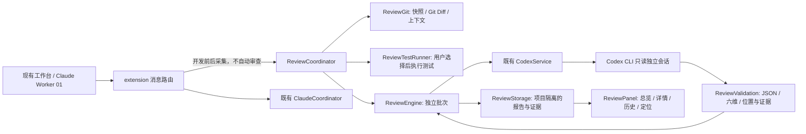

# Task 04：GPT 深度代码审查引擎

日期：2026-11-12。版本：0.5.0。范围：独立审查、证据、结构化报告及现有 UI 中的展示。不包含自动纠偏、代码修改、Claude 纠正指令、任务调度或多 Claude。

## 交付与环境

- 项目：`D:\Desktop\AI-Team-Manager`，Git 基线 `d3e1076`，master → origin/master。
- 上游：https://github.com/dreamcather726/AI-Team-Manager 。提交哈希与推送结果见本次交付消息。
- VS Code 1.146.0，Windows x64；Node v26.13.1，npm 11.20.0，Git 2.56.0.windows.1。
- 真实模型使用本机已有 Codex CLI 与既有授权 / 模型配置；Claude 使用已有 2.1.322。未填写、读取或保存 API Key，未修改 CC Switch 或系统 PATH。
- 安装包：`ai-team-manager-0.5.0.vsix`，17 个文件，约 84 KB。源码、测试、`.tools`、node_modules 与测试报告未进入 VSIX；运行时只有本地资产，无 CDN。
- VSIX SHA-256：`30ab0e5055b8037d96b81cafbf85ceeb075f8e439486f0fd8847eefea41fbfbb`。

## 模块结构与调用关系



新增生产模块：

| 文件 | 职责 |
| --- | --- |
| `src/review/reviewTypes.ts` | 任务、快照、测试、问题、六维结果和报告类型 |
| `src/review/reviewSafety.ts` | 相对路径检查、敏感路径 / 构建资产排除、常见秘密遮盖 |
| `src/review/reviewGit.ts` | 执行前和当前真实快照、HEAD 回退、实际 Git 生成 patch、必要测试及模块上下文 |
| `src/review/reviewTests.ts` | 明确选择的测试进程、退出码、可识别用例数、超时 / 停止与源码摘要绑定 |
| `src/review/reviewPrompt.ts` | 分批、原始行号、六维结构化审查提示 |
| `src/review/reviewValidation.ts` | 枚举 / 字段 / 六维校验、逐字证据及行号校验、结论门禁 |
| `src/review/reviewEngine.ts` | 独立 CodexService 实例和会话、批次证据、停止、过期检测、结果合并 |
| `src/review/reviewStorage.ts` | 项目路径哈希隔离、串行原子写入、报告和测试 / 任务记录 |
| `src/review/reviewCoordinator.ts` | VS Code 工作区、Claude 执行前后桥接、命令、历史和安全位置跳转 |
| `src/webview/workspace/reviewPanel.js` | 原右侧任务面板中的审查总览、严重程度统计、六维与问题详情、历史和位置按钮 |

修改：`src/extension.ts`、`src/providers/workspacePanel.ts`、现有 `workspace.js` / `workspace.css`；仅增加路由、命令、脚本加载和局部审查区域，没有重新设计五区域布局。`src/chat`、`src/claude`、Codex / Claude Service 和原有 CLI Adapter 均未重构。

项目文件：`package.json`、`package-lock.json`、`.vscodeignore`、`README.md`、`CHANGELOG.md`。新增 4 个命令：Review Claude Code Changes、Run Tests for Code Review、Stop Code Review、Code Review History。

测试新增：`test/review.test.cjs`、`review-fixture.cjs`、`fixtures/review/cases.cjs`、`review-live.cjs`、`review-boundaries-live.cjs`、`review-green-tests-live.cjs`、`task04-host-live.cjs`、`run-review-host.cjs`、`review-browser.cjs`。修改现有 test API、runner、宿主和工作台回归测试。

## 证据与结论规则

1. 正常 UI 发送 Claude 任务时，执行前保存真实文件快照。沿用同一会话时保留最初任务和快照，将补充指令追加保存；新任务使用新 Claude 会话。
2. 开发结束记录 Claude 实际 conversation / Session / request ID、状态和最终回答。最终回答不是文件或测试证明。
3. 对照实际文件哈希生成新增 / 修改 / 删除列表。Git `diff --no-index` 对前后文本生成 patch，包含真实前后代码和行号。执行前已存在的用户改动留在基线中。
4. 没有捕获基线时只能比较 Git HEAD；明确指出可能混入用户改动，不能自动 PASS 或断言属于 Claude。即使有快照，也不能独占归因同时发生的用户 / 其他进程编辑。
5. 测试在用户选择后真正执行。结果带命令、时间、退出码、输出、可识别用例数及源码摘要。缺少与当前代码匹配的实际测试记录时 BLOCKED。
6. 退出 0 但无用例、无法识别执行数量、已停止 / 超时、测试期间代码变化，均不能当成当前代码测试通过。结果不是对测试语义正确性的保证，测试源码同时送审以检查覆盖不足。
7. GPT 逐批审查 REQUIREMENTS、ARCHITECTURE、LOGIC、SECURITY、PERFORMANCE、TESTING；使用独立会话，不复用 GPT 聊天 thread 或 Claude Session。
8. 报告强制结构化。每个问题有 issue_id、severity、category、file_path、line_number、basis、problem_description、evidence、impact、suggested_fix、confidence、evidence_status。
9. 逐字验证代码引用确实从所报行开始。无法验证的位置保留为 UNVERIFIED，要求人工复核，不能作为已核实问题跳转。机械校验只证明引用存在，不证明模型的语义判断必然正确。
10. CRITICAL / HIGH 已验证问题强制 REQUEST_CHANGES。缺口 / 解析 / 进程失败、未完成批次或代码变化时 BLOCKED。跨批或不确定技术判断为 NEEDS_HUMAN_REVIEW。没有评分通关机制。
11. 审查进程在插件存储下隔离的证据目录运行，沿用已有只读 CodexService；不复制原始用户仓库配置，不执行测试或项目命令。若接口观察到审查模型自行调用工具则结果不通过。没有增加新的系统沙箱，也没有重写既有 Codex 外部工具配置。

## 五类真实 GPT 验收

最新完整证据：`.tools/task04-live-1794492468084/`。每类包含真实 Git 工程、实际执行的 Node 测试，以及 `*-report.json`、批次输入 / 模型原始输出和 Session。`results.json` 汇总如下。

| 样例 | 实际测试 | GPT 审查 | 已验证位置与结论 |
| --- | --- | --- | --- |
| correct | PASSED | PASS | 有限实数夹取 0..100；0、100、负数、区间值、小数、超限、NaN / ±Infinity 用例实际运行；没有 HIGH / CRITICAL 误报 |
| logic | FAILED | REQUEST_CHANGES | `worker.cjs:3`，HIGH / LOGIC；负数错误返回绝对值 |
| resource-leak | FAILED | REQUEST_CHANGES | `worker.cjs:3`，HIGH / LOGIC；openSync 后没有 closeSync / finally，成功及异常路径泄漏描述符 |
| out-of-bounds | FAILED | REQUEST_CHANGES | `worker.cjs:3`，HIGH / LOGIC；`i <= values.length` 访问无效索引，空数组和正常求和错误 |
| requirement-omission | FAILED | REQUEST_CHANGES | `worker.cjs:4`，HIGH / REQUIREMENTS；返回对象缺少必需 max 字段 |

五次真实 Codex Session（与表中顺序一致）：

```text
01a1d016-1027-7ad3-a4e0-f37c412dd13a
01a1d016-8bfe-71b1-925b-b5f1137c7c1a
01a1d017-2a6a-7da1-8adb-00fa911337b1
01a1d017-b1c4-7973-8353-f0dc00513d73
01a1d018-60b1-7212-be60-bb739e640fd4
```

模型建议分别包括：负数返回 0；在 openSync 成功后用 try/finally 保证关闭；循环使用 `<`；计算并返回 max、初始化支持全负数。建议只写入报告，未执行自动修改。五个样例的审查前后源码哈希均一致。

这些是明确构造的验收样例，不冒充 Claude 的真实产出。下面的正常宿主验收另外验证了真实 Claude 开发结果进入真实 GPT 审查。

## 补充真实模型边界测试

| 场景 | 实际结果 / 记录 |
| --- | --- |
| 缺少测试证据 | `.tools/task04-live-1794492468084/missing-evidence-report.json`：BLOCKED，真实 Session `01a1d030-1397-77d2-b89c-3de07f079536` |
| 审查期间并发编辑 | 同目录 `stale-evidence-report.json`：stale=true、BLOCKED；Session `01a1d030-b435-7121-9d80-b3e596568abe`；并发改动由独立验收脚本制造，结束后恢复该隔离样例 |
| 测试全绿但功能错误 | `.tools/task04-green-tests-1794494614908/report.json`：实际执行 1 个只覆盖正数的用例并 PASSED；GPT 仍定位负数错误到第 3 行，REQUEST_CHANGES；Session `01a1d036-d1fa-76a0-8968-ccc21f680b37` |

没有使用模拟审查结果来判定以上验收通过。结构校验与 UI 的人工对象仅用于单元测试，不计为真实模型验收。

## 最终 VSIX 正常宿主验收

测试使用最终 `ai-team-manager-0.5.0.vsix` 安装到隔离扩展目录，正常 Extension Development Host 连续启动两次，并非只调用纯函数。

证据：`.tools/task04-host-1794494830547/`；独立工程：`.tools/task04-host-fixture-1794494830336/`。

1. 插件激活、4 个审查命令注册、工作台 Webview ready。
2. 本机真实 Claude 按验收脚本的明确要求写入故意有缺陷的 `worker.cjs`；测试脚本随后提供正常夹取需求作为独立审查的原始验收规格。这不是生产任务被自动破坏。
3. 保存真实 Claude 前后快照、最终回答和 Session `4745d5b7-e894-43a1-ac5b-9a140b52132a`。仅 `worker.cjs` 发生变化。
4. 通过生产测试服务执行 `node --test`，实际出现 `5 !== 0`，退出 1，记录 FAILED。
5. 生产 ReviewCoordinator / Engine 使用真实 Codex 返回 REQUEST_CHANGES，问题定位第 3 行；报告 ID `87800b5e-4c48-41ad-b461-b9158c1d1ff2`。
6. 调用同一 UI 使用的位置处理器，VS Code 打开实际 `worker.cjs` 并选中第 3 行。原 GPT 聊天快照与 Claude Session 均未被审查流程修改。
7. 退出并重启宿主，审查历史、报告结论、Claude Session 均恢复，文件未被审查修改。

`stage1.json`：realClaude=true、realGPT=true、locationOpened=true、uiReady=true。`stage2.json`：reviewHistoryRestored=true、claudeSessionUnchanged=true、sourceUnchanged=true、uiReady=true。

最终 VSIX 的 GPT / UI 回归证据：`.tools/task02-host-1794494853909/`。专用 Mock Codex 验证原 GPT 发送、多轮、同 thread 重启恢复、面板与 CSP、全部原命令和新增审查命令。此回归明确不是一次真实 GPT 供应商请求；真实 GPT 验收由上面的五类、边界和正常宿主记录提供。

## UI、构建与回归

- 自动测试：44/44 通过，包括既有 GPT / Claude / 布局回归及新证据、路径、秘密遮盖、错误行号、缺失维度、高严重度结论、零用例、历史损坏和 UI 路由测试。
- `npm install` 成功，181 packages，audit 0 vulnerabilities。npm 提示已有两项安装脚本未加入本机 allowScripts；未改变授权策略，现有构建工具正常运行。
- `npm run typecheck`、`npm run compile`、`npx @vscode/vsce package` 成功。
- 最终 VSIX 实际安装、正常宿主真实 Claude/GPT 两次启动、GPT/UI 回归两次启动全部通过。
- 页面截图 / 验证：`.tools/task04-screenshots/review-real-report.png`、`review-light.png`、`review-mobile.png`。使用真实宿主报告快照和生产 Webview 资产本地渲染，非 Windows 外框截图；没有制作模拟在线审查。
- 深浅色、390px 小屏、位置消息路由通过，页面错误及 console.error 为 0。问题正文通过 textContent 显示，未执行报告中的 HTML。

验证中发现并修正：Windows 深层全局存储路径导致临时 Git 初始化失败，缩短证据目录并为只读 Git 命令设置临时 longpaths 配置；Node 测试上下文环境可能使嵌套测试退出 0 却未执行，现对子测试进程移除该内部上下文，并要求识别到正数用例。失败记录未计入通过结果。

## 已知问题与边界

- 分批能力已实现并用分片 / 行号自动测试验证；未声称进行过大型生产仓库压测。单文件 512 KiB、项目文本 16 MiB、上下文 64000 字符、单批提示 180000 字符、最多 100 批。超限明确 BLOCKED；多批即使逐批通过，整体仍要求人工核对跨批关系。
- Git 仓库根目录才支持可靠基线。没有 Git、目录不符、符号链接 / 子模块、相关二进制或敏感文件无法审查时明确报告缺口，不偷偷越权读取。普通文本文件内容审查不覆盖完整文件权限元数据。
- 已忽略的文件和排除的依赖 / 构建 / 二进制资产不在文本审查范围。动态导入、反射或复杂跨模块关系可能缺乏足够上下文，模型应明确不足；不能保证发现全部错误。
- 测试数量识别支持 Node / 常见 Jest、Vitest、Mocha 摘要；未知输出格式会 UNVERIFIED，不把退出 0 自动等同测试通过。测试进程及用例数量仍不能证明测试本身充分、可信，需结合源码审查。
- 只在用户明确选择后运行 npm / Node 测试，可能运行项目脚本。模型审查自身不执行测试，也不让 Claude 自述替代测试记录。
- 报告是特定时间的代码快照；历史 PASS 不代表后续编辑自动通过。审查期间变更会 BLOCKED，完成后变更会拒绝旧行定位。没有实现实时监督或自动纠偏。
- 同一 Claude 会话按一个任务追踪，后续指令追加保存；开始独立新任务应新建 Claude 会话。原始 GPT 技术要求由用户明确提供，避免自动绑定无关聊天。
- 秘密遮盖和敏感路径排除尽力减少泄露，不能识别所有自定义格式秘密。报告、测试输出和代码上下文仍可能敏感，保存在本机插件存储；不提交运行数据。历史没有自动清理，大量记录会增加磁盘和内存占用。
- 沿用既有只读 CLI 沙箱与配置，不宣称新增系统级命令拦截或安全隔离。建议仅在可信项目运行测试。
- 保留原有用户修改。未改 `.gitignore`，不提交 dist、node_modules、VSIX 或 `.tools`。本阶段结束后不继续后续功能。
