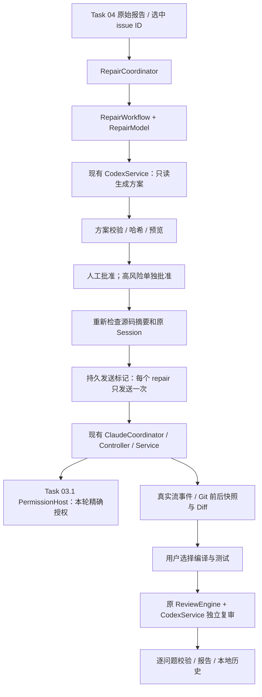

# Task 05 交付与真实验收记录

日期：2026-11-13（Asia/Shanghai）。版本：0.6.0。Task 05 已完成单轮人工审批修复闭环，未开发后续自动循环或调度。

## 新增与修改模块

| 文件 | 职责 |
| --- | --- |
| `src/repair/repairTypes.ts` | 修复计划、审批、执行记录、逐问题验证及忽略/人工处理数据结构 |
| `src/repair/repairModel.ts` | 使用现有 CodexService 生成方案；校验文件范围、问题关联及风险，计算方案哈希 |
| `src/repair/repairWorkflow.ts` | 单轮状态、持久化、防重复派发、真实变更/测试采集、调用原审查引擎及结果校验 |
| `src/repair/repairCoordinator.ts` | 复用工作台消息、原生高风险审批、检查命令选择、历史与报告展示 |
| `src/webview/workspace/repairPanel.js` | 问题筛选/多选、处置、方案预览、批准/修改/延后/拒绝、Diff/用量/历史 |
| `src/claude/claudeController.ts`、`claudeCoordinator.ts` | 为原通信链路增加可选事件观察器和本轮权限覆盖；不替换 CLI Adapter |
| `src/permissions/permissionManager.ts`、`permissionPolicy.ts` | 复用 Task 03.1 Hooks；锁定方案允许文件，拒绝本轮普通终端命令及未批准删除 |
| `src/review/reviewTypes.ts`、`reviewPrompt.ts`、`reviewValidation.ts`、`reviewTests.ts` | 原六维引擎的可选修复关联、真实未变文件、编译证据及逐字位置校验；不重写引擎 |
| `src/review/reviewCoordinator.ts`、`src/extension.ts` | 修复与原审查/开发任务互斥；注册入口、生命周期、真实日志 |
| `src/providers/workspacePanel.ts`、`workspace.js`、`workspace.css` | 装载新增面板，沿用现有布局/主题变量 |
| `test/repair.test.cjs`、`workspace.test.cjs` | 审批、范围、异常、状态、真实 Diff/测试进程、UI 消息与安全渲染回归 |
| `test/repair-fixture.cjs`、`run-repair-host.cjs`、`task05-host-live.cjs` | 独立 Git 工程、真实模型、最终 VSIX 原生宿主及重启验收 |
| `test/repair-verification-live.cjs`、`repair-screenshots.cjs` | 真实 GPT 故障场景与生产 Webview 资产截图 |

另更新 `test/api.ts`、`test/run.cjs`、`package.json`/锁文件、`.vscodeignore`、README、CHANGELOG 和本报告。没有修改 `.gitignore`。

## 调用链路



计划生成、Claude 执行、编译测试及复审均由明确操作触发，不自动串成无限循环。原 GPT 聊天与 Claude Session 独立；修复审查采用新的只读 GPT 会话。

## 数据结构与审批约束

`RepairPlan` 包含以下字段：

```ts
{
  repair_id, review_id, task_id, issue_ids,
  title, problem_description, root_cause,
  target_files, allowed_files, forbidden_files,
  repair_strategy, acceptance_criteria, test_requirements,
  risk_level, delete_files, public_interface_changes, missing_context
}
```

记录还保存 `original_issues`、`plan_hash`、执行前快照、原会话标识、审批时间/来源/方案哈希/源码摘要/分别批准的风险、发送标记、工具和授权事件、实际 Diff、检查结果、验证报告 ID、逐问题结论和每次 GPT usage。

- 审批只针对预览的确切哈希。过期哈希、变化的源文件、未恢复的原 Session、缺少上下文或高风险单独审批，均阻止发送。
- 模型不能突破原任务显式的 allowed/forbidden 约束。没有被列入 allowed 的其他文件，包括新路径，均禁止修改。
- 本轮范围不写入用户持久权限设置。删除、工程配置仍受 Task 03.1 工具审批保护；不启用全局权限绕过。
- 发送标记在触及 Claude 前持久化。中断恢复为 INTERRUPTED，既不自动重发，也不自动创建新 Session。
- 状态：DRAFT、DEFERRED、REJECTED、SENDING、EXECUTED、FAILED、VERIFYING、FINISHED、INTERRUPTED。

## 最终 VSIX 的真实修复案例

最终宿主证据目录：[task05-host-1794504194568](.tools/task05-host-1794504194568/)。安装最终 VSIX 后连续启动两次正常 Development Host，使用正常本地持久化存储。

| 项目 | 实际记录 |
| --- | --- |
| 原任务 | 有限数夹到 0..100；负数返回 0；非有限数抛 TypeError；保留 CommonJS 接口，只改 worker.cjs |
| 原始审查 | `f1deaff0-8fc0-4f8f-a63f-6a4cfb374b3a`，REQUEST_CHANGES |
| 原始问题 | `B1-1`，HIGH / LOGIC，worker.cjs:3，逐字代码证据 VERIFIED |
| 修复 ID | `306a64be-094c-4296-871f-d29b20680c28` |
| 原 Claude Session | `44ac0887-b5ab-4d1c-a58e-25625214bdaa`，两次真实任务使用同一 Session |
| 方案 | 只把负数分支 `Math.abs(value)` 改成 `0`；保留上界、有限数检查、导出与其他文件 |
| 复审报告 | `d7088ba6-8cb3-4fcc-b6f4-278ba2f44eac`，PASS，B1-1 = FIXED |
| 受保护文件 | sample.test.cjs、README.md、package.json、input.txt 前后完全一致 |
| CLI | Codex 0.167.0-alpha.4.1；Claude Code 2.1.322 |

缺陷样例由测试明确要求真实 Claude 写入；原始需求由测试显式传给独立审查，未把“保留故意错误”的造样例指令误当成功能要求。真实 GPT 发现错误、生成方案，真实 Claude 再执行修复。

审批动作由验收程序通过生产 `repairApprove` 消息处理器显式执行，并记为 `TEST_HARNESS_VIA_PRODUCTION_UI_MESSAGE`。这不是人工点击的声明，也不是模型自动批准。生产记录中的 `USER_WORKBENCH_PREVIEW` 标识审批入口；测试阶段另行记录实际动作来源。

实际 Git Diff：

```diff
 function run(value) {
   if (!Number.isFinite(value)) throw new TypeError('finite number required');
-  if (value < 0) return Math.abs(value);
+  if (value < 0) return 0;
   return Math.min(100, value);
 }
 module.exports = { run };
```

实际执行 `npm run compile`（本工程脚本为 `node --check worker.cjs`）退出 0。实际 `node --test` 退出 0，1 个测试用例通过；该用例验证负数、0、0.25、50、100、150、NaN、±Infinity。修复前同一测试真实失败，没有修改测试规避失败。

完整原始记录：[原始审查](.tools/task05-host-1794504194568/original-review.json)、[修复记录](.tools/task05-host-1794504194568/repair-record.json)、[GPT 复审](.tools/task05-host-1794504194568/verification-review.json)、[首次宿主结果](.tools/task05-host-1794504194568/stage1.json)、[重启结果](.tools/task05-host-1794504194568/stage2.json)。这些运行数据保留本地，不进入 Git 提交或 VSIX。

## 四种验证结果

| 场景 | 真实证据 | 最终状态 |
| --- | --- | --- |
| 原 Session 执行批准方案 | Claude 修改一行；实际编译/测试通过；GPT 六维审查 PASS | FIXED |
| 保持原错误代码不变 | GPT 看到真实 UNCHANGED 文件；负数测试失败，精确定位原错误 | NOT_FIXED |
| 修复负数但移除上界处理 | GPT 定位新代码 `return value`；150 边界测试失败 | REGRESSION |
| 代码已改但不运行测试 | GPT 总审查 BLOCKED；缺少实际测试记录，服务端阻止单项 FIXED | UNVERIFIED |

后三项由测试程序对独立工程做实际代码故障注入，再调用真实 GPT，并非额外 Claude 修复任务或伪造审批/输出。结果：[实际场景结果](.tools/task05-verification-1794504043623/results.json)。NOT_FIXED 和 REGRESSION 复用了先前真实模型报告并重新验证源摘要，不重复调用模型浪费 Token。

NOT_FIXED 场景的整体审查仍为 BLOCKED（缺少编译等整体证据），但已验证的原代码错误和失败测试足以证明“该问题仍存在”；这不表示整体通过。UNVERIFIED 场景中，模型单项曾声称 FIXED，服务端依据总审查和缺失测试将其降级，未把未执行测试标为通过。

测试期间修正了两处实际验证边界：否定结论不被无关缺口覆盖；回归证据允许精确的多行代码片段覆盖新问题行，同时仍要求独立 VERIFIED 新问题及真实新增/修改证据。另修正 UI 测试自身缺少 verdict 的不完整样本。

## 验证结果与日志

| 检查 | 结果 |
| --- | --- |
| npm install | 完成；audit 0 vulnerabilities |
| TypeScript / compile | `npm run typecheck`、`npm run compile` 通过 |
| 自动化回归 | 59/59 通过；含现有 GPT/Claude、Windows .cmd、停止、异常、Session、权限、审查和布局测试 |
| 审批及防重复 | 未批准不发送；拒绝/延后可持久化；过期哈希、审批中代码/Session/计划变化、缺少高风险审批均阻止发送 |
| 真实闭环 | 最终 VSIX 中真实 GPT 方案 → 显式审批动作 → 原 Claude Session 修复 → 真实 Diff/检查 → 真实 GPT PASS/FIXED |
| 重启 | 原 Session、方案、审批和验证历史恢复；重复点击仍不发送 |
| 原功能宿主回归 | `.tools/task05-regression-host-1794504518002`：命令、4 个视图、CSP、编辑器 WebviewPanel、布局及 GPT 多轮/重启通过；GPT 对话使用受控 CLI，非真实模型验收 |
| 深/浅/窄屏 | 4 张真实宿主快照渲染；1900px 深/浅色、620px 窄屏，无页面横向溢出或浏览器异常 |
| VSIX | 打包通过，已安装至当前 VS Code；19 个文件，不含测试/运行数据/源码 TypeScript/依赖目录 |

关键日志（从实际 UTC 事件换算到 Asia/Shanghai）：

```text
2026-11-13 01:24:33  APPROVED / DISPATCH_COMMITTED，绑定方案哈希和源码摘要
2026-11-13 01:24:34  Claude 原 Session 启动
2026-11-13 01:24:42  Edit running → WRITE ALLOW（Hooks）→ Edit completed
2026-11-13 01:24:53  Claude result，执行结束
2026-11-13 01:24:54  修复状态 EXECUTED；npm run compile PASSED
2026-11-13 01:24:55  node --test PASSED
2026-11-13 01:25:24  GPT 复审 PASS；原始 B1-1 = FIXED
```

浏览器 `pageerror=[]`。原生宿主退出码 0；平台日志仍有 VS Code 自身的 mutex、MCP marketplace policy、Node URL 弃用和退出时 Canceled/代理取消消息，不能声称整个 VS Code 日志零错误；未发现本插件的未处理异常。

## GPT Token 使用

最终真实闭环的修复用量直接取 CLI usage：

| 阶段 | 输入 | 缓存输入（已包含于输入） | 输出 | 总计 |
| --- | ---: | ---: | ---: | ---: |
| 修复方案 | 19,094 | 13,696 | 402 | 19,496 |
| 修复复审 | 21,858 | 13,696 | 651 | 22,509 |
| 本次修复合计 | 40,952 | 27,392 | 1,053 | 42,005 |

最终工程原始 Task 04 审查另用 20,237 Token；三类故障验证另用 64,301 Token。此前开发验证的原始审查及完整闭环共 61,562 Token。本次 Task 05 开发验证合计 9 次真实 GPT 调用，188,105 Token。缓存不重复相加；不据此估算货币费用。版本检查、自动化单元测试和受控 CLI 宿主回归不调用模型。

方案只提交选中问题及其变更/当前代码，复用 Task 04 有限依赖与测试上下文，不重发整个项目。宿主快照比较全部已采集文本是为了检测越权和并发变化，并非把所有源码送入模型。过大的必要上下文直接提示缩小范围，不静默省略后宣称通过。

## 截图和安装包

- [方案预览（深色）](.tools/task05-host-1794504194568/screenshots/plan-dark.png)
- [实际结果（深色）](.tools/task05-host-1794504194568/screenshots/result-dark.png)
- [实际结果（浅色）](.tools/task05-host-1794504194568/screenshots/result-light.png)
- [实际结果（窄屏）](.tools/task05-host-1794504194568/screenshots/result-narrow.png)
- [安装包](ai-team-manager-0.6.0.vsix)

截图使用实际宿主会话快照与生产 Webview 资产，仅重现主题和面板滚动，不编造聊天/状态，也不是 Windows 外框截图。原始记录、截图和 VSIX 是本地交付物，不纳入源码 Git 备份。

VSIX SHA256：`C4A0A1E93215A5C4BBAC370E97F4D9588E0E292736E14EEA6FEF6FB0BA2EAC75`。

## 已知限制

- 只支持已有本地 Git 根目录、原 Claude Session 和单轮修复。没有自动重试、循环修复、多 Agent、Grok、Worktree、调度或自动扩大范围。
- 用户必须在当前快照执行必要检查；缺少实际测试、跨批整体验证、代码过期、执行或日志缺口均不能自动 FIXED。大型项目可以分批，跨批修复结论保守转为 UNVERIFIED。
- Hooks 只拦截启用的 Claude 工具调用。外部编辑/进程无法预先阻止；已批准测试脚本会执行项目代码，不构成操作系统沙箱。不会破坏性回滚用户文件。
- 公共接口等语义约束由审批与独立审查共同检查，不能靠文件白名单证明所有语义行为。高风险实际删除未用于真实模型验收，防线通过策略/审批回归及已有 Task 03.1 机制验证。
- 最终回答在修复记录中最多 32000 字符，完整回答保留原会话。事件超过 5000 条显式记缺口；本地历史未提供自动清理。密钥常见模式脱敏不保证覆盖所有自定义秘密。
- 重启时执行中记录保留为 INTERRUPTED；出于防重复要求，即使派发是否送达不确定，也不自动再发。

源码与本报告按当前 `master` 上游同步；未把现有 `dist/extension.js`、`node_modules/.package-lock.json` 改动、运行数据或安装包纳入本次提交。最终提交哈希与 Push 状态见交付回执。
